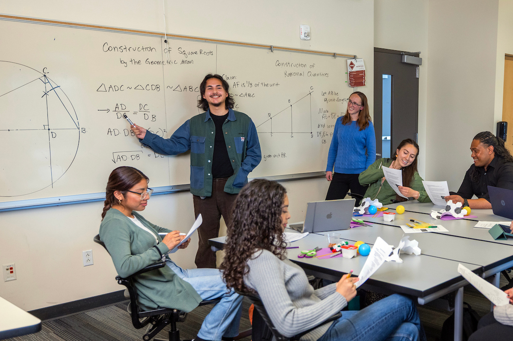
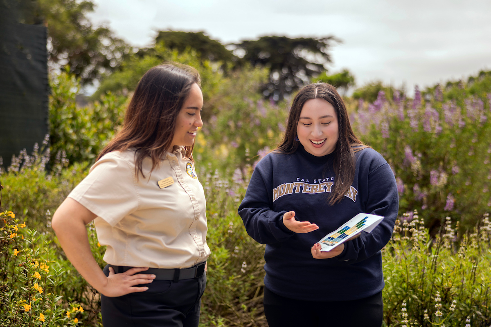
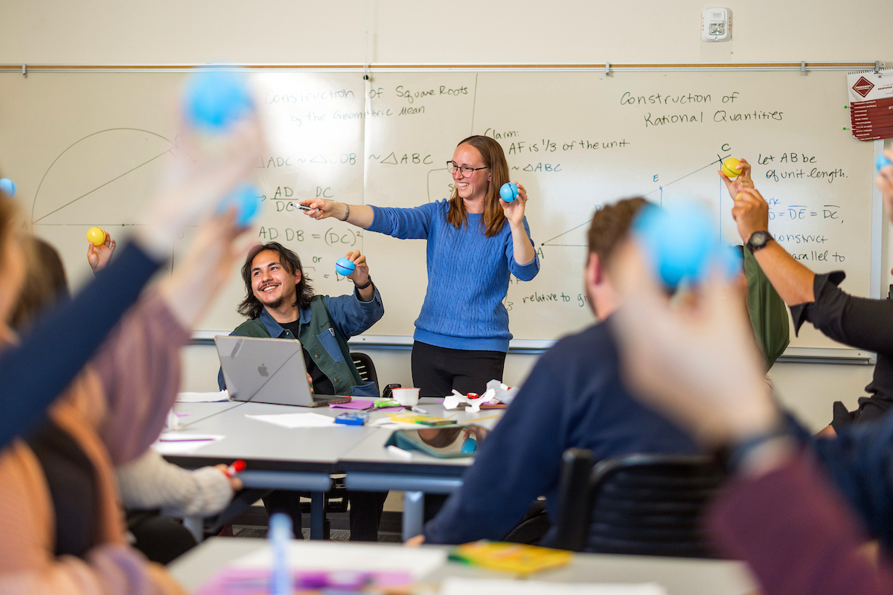
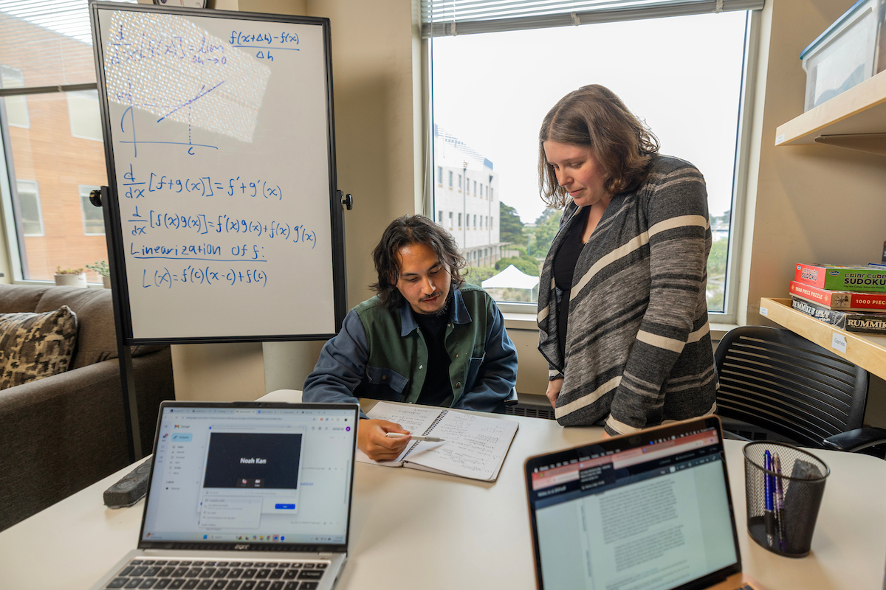
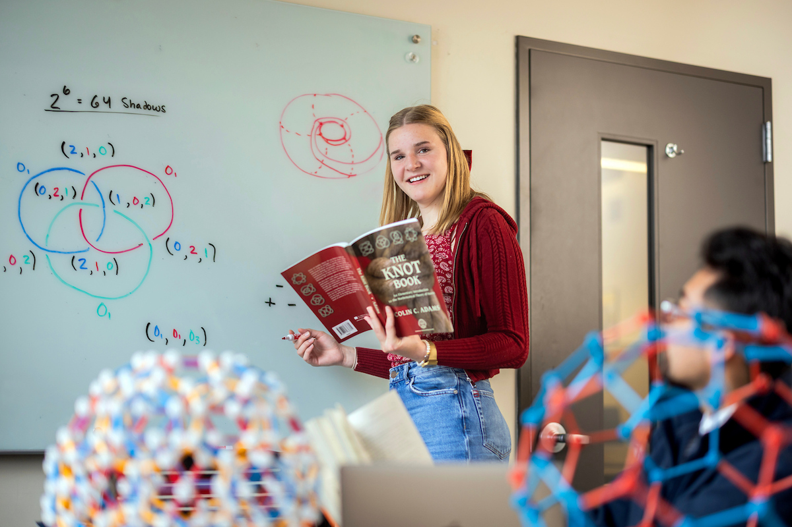
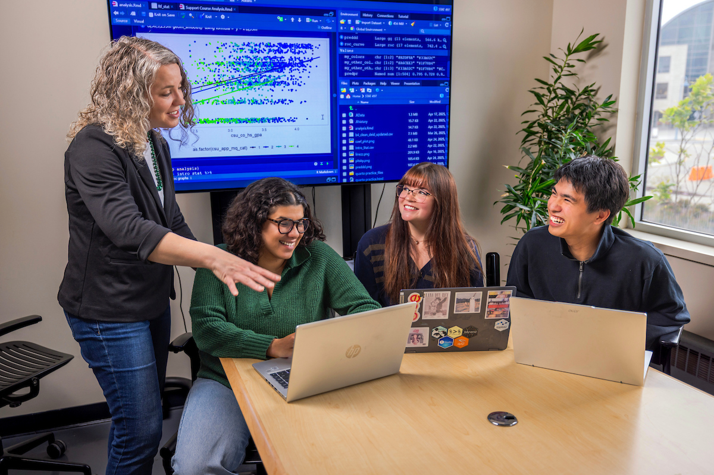

:::: {#math-careers}

{fig-align="center"}

::: {.hero}

Career exploration · Mathematics · Statistics & Data Science 

# Where could math take you?

Answer five quick questions to explore a math career path that may fit your interests. Then browse salary snapshots, training ideas, and possible job titles. There are no wrong answers.
:::

::: {.callout-note .program-note}
## Explore Math and Statistics at CSUMB
Our programs include Mathematics for Teaching, Pure & Applied Math, and Statistics & Data Science. Our programs include small classes, faculty mentorship, hands-on learning, research, and service-learning. Career paths can overlap. Use these snapshots to decide what you’d like to learn more about.

[Mathematics](https://csumb.edu/math/) · [Statistics & Data Science](https://csumb.edu/stat/)
:::

::: {.photo-band}

{fig-cap="Collaborative problem-solving in a math classroom"}

{fig-cap="Using data to explore questions beyond the classroom"}

:::

<strong>Your career-fit check-in</strong>Question 1 of 5

<form id="career-quiz"><fieldset><legend id="quiz-question"></legend>

</fieldset>

<button class="btn btn-secondary" type="button" id="quiz-back">Back</button><button class="btn btn-primary" type="button" id="quiz-next">Next</button>
</form>

Your strongest match

<h2 id="result-title"></h2>

<button class="btn btn-primary" type="button" id="result-guide">Explore your career guide</button>
<button class="btn btn-secondary reset" type="button" id="quiz-restart">Take it again</button>

## Explore the four paths {#career-guides}

Career paths can overlap. Use these snapshots to decide what you’d like to learn more about.

### Math Teaching {#teaching .career-card}
{fig-cap="Collaborative problem-solving in a math classroom"}

#### **Focus: People + Explaining**

Help students build mathematical understanding, confidence, and problem-solving skills.

#### **Salary snapshot · California:** 
$85,107 median annual pay for high school teachers.

#### **Training to explore:** 
A bachelor’s degree in Mathematics followed by a credential degree is required in California (as one possible avenue). Courses in Calculus, Statistics, and Geometry as well as 45 hours of classroom experience are required for credential programs in California. All of these qualifications are met in the **CSUMB Mathematics for Teaching** Concentration. In addition, programs like *Math and Science Teacher Initiative (MSTI)* provide scholarship support to engage in activities to prepare you for the classroom. [Learn more about the CSUMB Mathematics Program.](https://csumb.edu/math/)

##### **Possible job titles:**

- High school math teacher
- Middle school math teacher
- Math intervention specialist
- Math curriculum specialist

#### **A day might include:** 
Planning lessons, explaining concepts in different ways, checking student work, and helping learners set goals.

### Applied Math {#applied .career-card}
{fig-cap="Building models to solve problems or answer questions"}

#### **Focus: Models + Real-world Problems**

Use mathematical models and computation to understand or improve real systems and practical problems.

#### **Salary snapshot · California:** 
$113,769 median annual pay for positions such as operations research analysts,  (May 2024), one career that uses applied math.

#### **Training to explore:** 
AA bachelor’s degree in mathematics, with a focus on applied classes such as modeling, numerical, and data analysis, with programming in Python and Matlab, are all skills gained through the **Pure and Applied Mathematics Concentration at CSUMB**. Our program provides experiential learning and research opportunities directly embedded in your courses, with additional opportunities for faculty mentored research and internships. Some specialized roles require graduate study, and we offer a special course to help you navigate the application process to Master’s and PhD programs. [Learn more about the CSUMB Mathematics Program.](https://csumb.edu/math/)

##### **Possible job titles:**

- Applied mathematician
- Operations research analyst
- Computational Scientist
- Quantitative analyst

#### **A day might include:** 
Turning a practical question into equations or a computer model, testing scenarios, and explaining what a solution could mean in the context of the problem.

### Pure Math {#pure .career-card}
{fig-cap="Exploring mysteries and making discoveries with mathematics"}

#### **Focus: Patterns + Proofs**

Study mathematical ideas for their structure, patterns, and proofs, including questions with no immediate practical use.

#### **Salary snapshot · California:** 
$114,970 median annual pay for mathematicians, but positions typically require a PhD. 

#### **Training to explore:** 
A bachelor’s degree prepare students for related work in areas such as Artificial Intelligence or Cryptography. Topics may include real analysis, abstract algebra, and number theory, all courses offered as a part of the **Pure and Applied Mathematics Concentration at CSUMB**. Since a PhD is typically required for research mathematician jobs, students can start research experiences early through course-based experiences followed by faculty mentored research. In addition, many students find support through the *Undergraduate Research Opportunities Center* to find additional summer research experiences. Finally, students can complete a special course to help you navigate the application process to a PhD program. [Learn more about the CSUMB Mathematics Program.](https://csumb.edu/math/)

##### **Possible job titles:**

- Research mathematician
- University mathematics professor
- Mathematical analyst
- Mathematics writer or editor

#### **A day might include:** 
Reading mathematical work, asking precise questions, developing proofs, writing results, or discussing ideas with other mathematicians.

### Statistics & Data Science {#data .career-card}

{fig-cap="Finding patterns and making predictions with data"}

#### **Focus: Data + Evidence**

Use data, probability, and computing to find patterns, measure uncertainty, and inform decisions.

#### **Salary snapshot · California:** 
\$136,000 median annual pay for statisticians and \$141,590 for data scientists.

#### **Training to explore:** 
The **CSUMB Statistics & Data Science** bachelor’s degree prepares you for many possible jobs in one of the fastest growing fields in the United States. The combination of both Statistics and Data Science provides you with the chance to choose your path, whether you test new treatments for diseases or use machine learning making predictions about ticket sales for a sports team. Since some roles require a master’s degree or PhD, our program mixes both theoretical foundations with computational methods so that you can easily transitions to graduate degree program. Students gain hands-on learning through course-based projects, a service-learning internship, and faculty-mentored research experiences or work as a consultant our data analysis center on campus.  [Learn more about the CSUMB Statistics & Data Science Program.](https://csumb.edu/math/)

##### **Possible job titles:**

- Statistician
- Data scientist
- Actuary
- Data or business analyst
- Biostatistician

#### **A day might include:** 
Cleaning data, choosing an analysis, checking whether a pattern is reliable, and communicating what the evidence can and cannot show.

::::

::: {.fine-print}
Salary figures are Californian medians from October 2026, not starting salaries or guarantees. Actual pay varies by location, employer, experience, and education. Some paths span several occupations, so a listed job is an example, not a complete salary estimate for the field. See the [BLS high school teacher](https://www.bls.gov/ooh/education-training-and-library/high-school-teachers.htm), [mathematician and statistician](https://www.bls.gov/ooh/math/mathematicians-and-statisticians.htm), [data scientist](https://www.bls.gov/ooh/math/data-scientists.htm), and [operations research analyst](https://www.bls.gov/ooh/math/operations-research-analysts.htm) pages for details on national medians and pay expectations. 

:::

{fig-align="center"}

