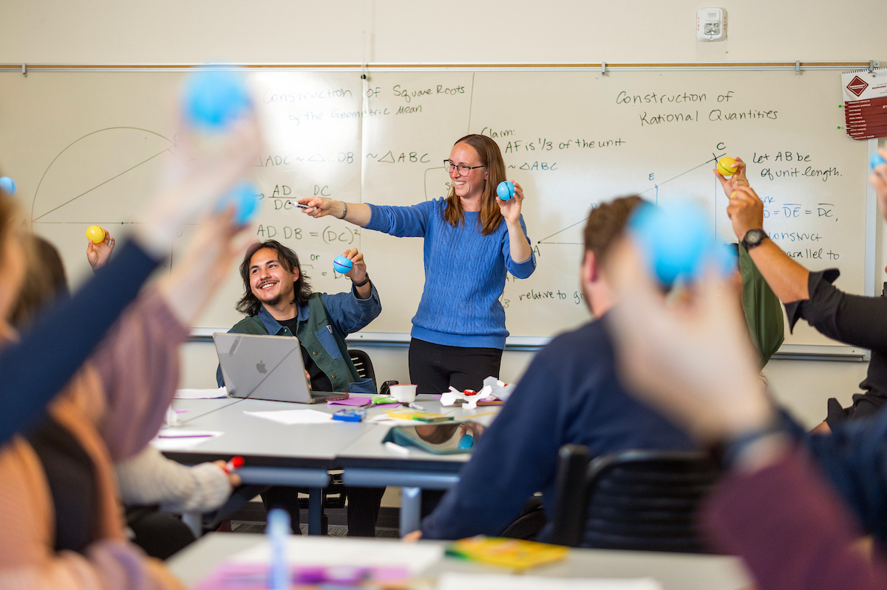
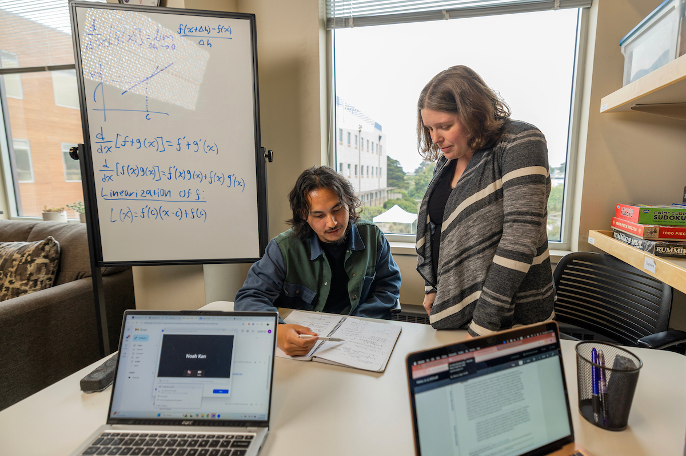
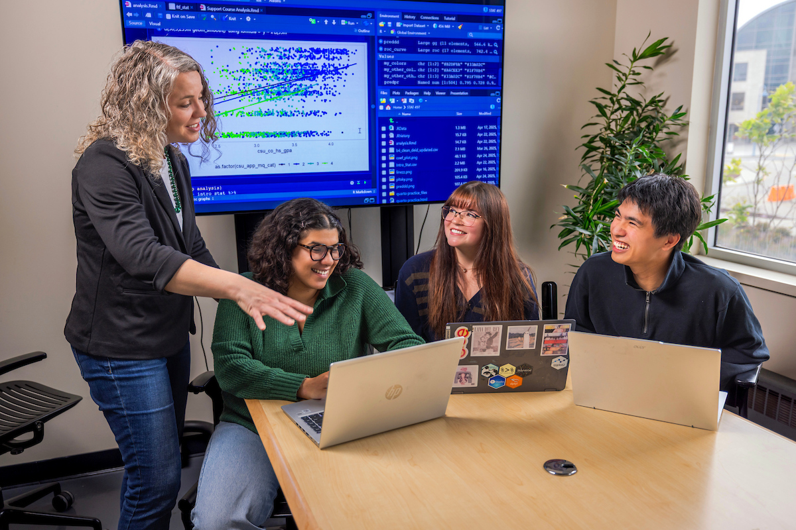

Answer five quick questions to explore a math career path that may fit your interests. Then browse salary snapshots, training ideas, and possible job titles. There are no wrong answers.

### Which activity sounds most satisfying?

A. Helping someone understand a math idea they found confusing  
B. Using math to solve a practical problem, such as improving a design  
C. Exploring why a mathematical idea is true and how it connects to others  
D. Finding patterns in data and using them to answer a real-world question  

### Which project would you choose?

A. Create a lesson or activity that makes a math topic easier to learn  
B. Use math to help design a safer bridge, faster route, or more efficient process  
C. Investigate a puzzle or theorem and write a proof  
D. Study survey or experiment results and explain what they reveal  

### Which question are you most curious about?

A. How can people learn challenging math concepts?  
B. How can math help us understand or improve real systems?  
C. What makes a mathematical statement true?  
D. What can data tell us, and how certain should we be?  
    
    
    
### When working with others, which role feels most appealing?

A. Explaining ideas and helping the group learn  
B. Applying math to the group’s practical challenge  
C. Exploring the logic behind the problem  
D. Organizing evidence and checking what the numbers support  

### If you could spend a day exploring one topic, which would you pick?

A. How students learn algebra or geometry  
B. How math can improve transportation, medicine, technology, or the environment  
C. Number patterns, geometry, infinity, or mathematical proof  
D. Data about health, sports, climate, business, or people  

### Find your Future Career

Count the total number of answers that were: 

A: _______

B: _______

C: _______

D: _______

If you had a majority ___, then you might be interested in...

A. **Math Teaching:** You may enjoy explaining ideas, supporting learners, and helping students grow more confident with math.  

B. **Applied Math:** You may enjoy using mathematical tools to model practical problems and improve real-world systems.  
    
C. **Pure Math:** You may enjoy exploring patterns, abstract questions, and the logic behind mathematical ideas.  
    
D. **Statistics & Data Science:** You may enjoy finding patterns in data, evaluating evidence, and helping people make informed decisions.  

## Explore the four paths 

Career paths can overlap. Use these snapshots to decide what you’d like to learn more about.

### Math Teaching 
{fig-cap="Collaborative problem-solving in a math classroom"}

#### **Focus: People + Explaining**

Help students build mathematical understanding, confidence, and problem-solving skills.

#### **Salary snapshot · California:** 
$85,107 median annual pay for high school teachers.

#### **Training to explore:** 
A bachelor’s degree in Mathematics followed by a credential degree is required in California (as one possible avenue). Courses in Calculus, Statistics, and Geometry as well as 45 hours of classroom experience are required for credential programs in California. All of these qualifications are met in the CSUMB *Mathematics for Teaching* Concentration. In addition, programs like *Math and Science Teacher Initiative (MSTI)* provide scholarship support to engage in activities to prepare you for the classroom. 

##### **Possible job titles:**

- High school math teacher
- Middle school math teacher
- Math intervention specialist
- Math curriculum specialist

#### **A day might include:** 
Planning lessons, explaining concepts in different ways, checking student work, and helping learners set goals.

### Applied Math 
{fig-cap="Building models to solve problems or answer questions"}

#### **Focus: Models + Real-world Problems**

Use mathematical models and computation to understand or improve real systems and practical problems.

#### **Salary snapshot · California:** 
$113,769 median annual pay for positions such as operations research analysts,  (May 2024), one career that uses applied math.

#### **Training to explore:** 
A bachelor’s degree in mathematics, with a focus on applied classes such as modeling, numerical, and data analysis, with programming in Python and Matlab, are all skills gained through the **Pure and Applied Concentration in Mathematics at CSUMB**. Our program provides experiential learning and research opportunities directly embedded in your courses, with additional opportunities for faculty mentored research and internships. Some specialized roles require graduate study, and we offer a special course to help you navigate the application process to Master's and PhD programs. 

##### **Possible job titles:**

- Applied mathematician
- Operations research analyst
- Computational Scientist
- Quantitative analyst

#### **A day might include:** 
Turning a practical question into equations or a computer model, testing scenarios, and explaining what a solution could mean in the context of the problem.

### Pure Math 
{fig-cap="Exploring mysteries and making discoveries with mathematics"}

#### **Focus: Patterns + Proofs**

Study mathematical ideas for their structure, patterns, and proofs, including questions with no immediate practical use.

#### **Salary snapshot · California:** 
$114,970 median annual pay for mathematicians, but positions typically require a PhD. 

#### **Training to explore:** 
Research mathematicians typically earn a PhD in mathematics. A bachelor’s or master’s degree can also prepare students for related work in areas such as Artificial Intelligence or Cryptography. Topics may include real analysis, abstract algebra, number theory, and complex analysis, all of which are courses offered as a part of the **Pure and Applied Mathematics Concentration in Mathematics at CSUMB**. Since a PhD is typically required, students can start research experiences early through course-based experiences followed by faculty mentored research. In addition, many students find support through the Undergraduate Research Opportunities Center and McNair Scholars Programs to find additional external summer research experiences. Finally, students can complete a special course to help you navigate the application process to a PhD program. 

##### **Possible job titles:**

- Research mathematician
- University mathematics professor
- Mathematical researcher
- Mathematics writer or editor

#### **A day might include:** 
Reading mathematical work, asking precise questions, developing proofs, writing results, or discussing ideas with other mathematicians.

### Statistics & Data Science 

{fig-cap="Finding patterns and making predictions with data"}

#### **Focus: Data + Evidence**

Use data, probability, and computing to find patterns, measure uncertainty, and inform decisions.

#### **Salary snapshot · California:** 
\$136,000 median annual pay for statisticians and \$141,590 for data scientists.

#### **Training to explore:** 
The Statistics & Data Science bachelor's degree prepares you many possible jobs in one of the fastest growing fields in the United States. The combination of both Statistics and Data Science provides you with the chance to choose your path, whether you want to work in clinical trials designing new treatments for diseases or machine learning making predictions about ticket sales for a sports team. Since some statistician roles require a master’s degree or PhD, our program mixes both theoretical foundations with computational methods and applications so that you can easily transitions to graduate degree program, with support through a special course to help with the application process.. Students gain hands-on learning through course-based projects, a service-learning internship, and can seek faculty-mentored research experiences or work as a consultant our data analysis center on campus.  You will build skills in coding, data visualization, experimental design, and communicating evidence to clients and the public alike. 

##### **Possible job titles:**

- Statistician
- Data scientist
- Actuary
- Data or business analyst
- Biostatistician

#### **A day might include:** 
Cleaning data, choosing an analysis, checking whether a pattern is reliable, and communicating what the evidence can and cannot show.

## Explore Math and Statistics at CSUMB

Programs include Mathematics for Teaching, Pure & Applied Math, and Statistics & Data Science. Our programs include small classes, faculty mentorship, hands-on learning, research, and service-learning.

**https://csumb.edu/mathstat**

{fig-align="center"}

::: {.fine-print}
Salary figures are Californian medians from October 2026, not starting salaries or guarantees. Actual pay varies by location, employer, experience, and education. Some paths span several occupations, so a listed job is an example, not a complete salary estimate for the field. See the [BLS high school teacher](https://www.bls.gov/ooh/education-training-and-library/high-school-teachers.htm), [mathematician and statistician](https://www.bls.gov/ooh/math/mathematicians-and-statisticians.htm), [data scientist](https://www.bls.gov/ooh/math/data-scientists.htm), and [operations research analyst](https://www.bls.gov/ooh/math/operations-research-analysts.htm) pages for details on national medians and pay expectations. 

:::

